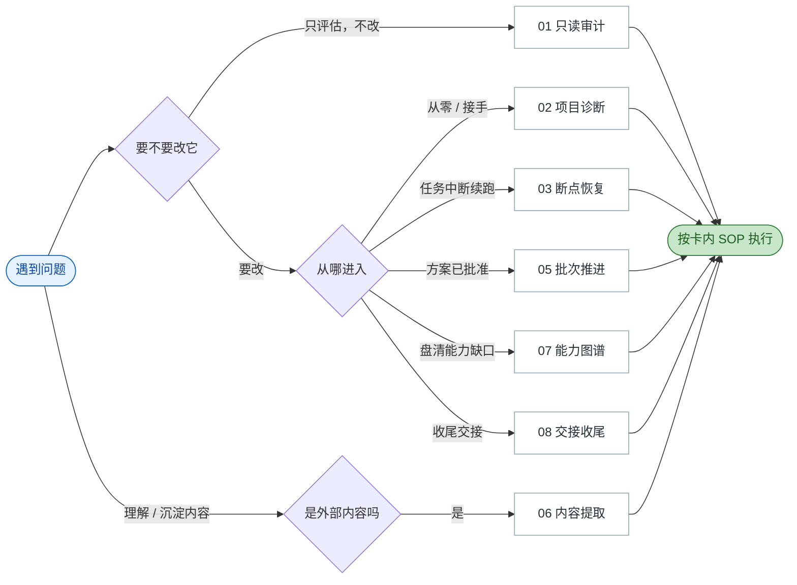

# 经验手册

> 从 5 个月、2,794 个真实编码会话中蒸馏出的可复用经验。
> 不是"AI 工具清单"，而是**经过双模型复现门验证的工作方法**。

---

## 这是什么

一本从真实工作记录里淘出来的手册。每一条经验都满足三个条件：

1. **有数据支撑**——在 2,794 个会话里统计过出现率
2. **不是配置回声**——排除了写在配置文件（AGENTS.md / skills）里的做法
3. **过了复现门**——第二个模型独立抽取同一批会话，一致率 ≥70%

最终得到 **17 张经验卡** + **6 条稀有真经** + **8 类反模式** + **一套可复用的蒸馏方法**。

---

## 怎么用

### 第一步：选卡



完整的三张决策图见 [books/速查单页.md](books/速查单页.md)。

### 第二步：叠加纪律

| 时机 | 挂哪张 |
|---|---|
| 执行前 | 12 别说过头 · 16 别装懂 · 17 默认拒绝 |
| 执行中 | 04 对抗性审查 · 10 视觉验收 · 13 别卡住 · 14 别空口 |
| 交付前 | 15 别做漏 |

### 第三步：交付前过红线

不升级证据 · 不隐藏未知 · 不空口无据 · 不做漏。

---

## 目录

```
books/
├── 速查单页.md          ★ 三张决策图，日常入口
├── 00-总索引.md          完整索引与分册
├── 元层-蒸馏方法.md      ★ 怎么生产经验（最可迁移）
├── 稀有真经.md           低频但硬的 6 条
├── 反模式清单.md         8 类常见出错方式
├── 工具调用画像-否定发现.md  两次假设被证伪 + 指标陷阱
├── 复盘-写真Agent项目.md
├── 复盘-Skill知识库项目.md
├── 上下文成本-发现.md    token 成本超线性增长
├── 方法演进史.md          5 个月行为趋势 + 归因纠错
├── 实战演练-手册自审.md   用手册审计手册的真实记录
├── 跨岗通用.md           01 / 03 / 04
├── A-商业分析专家.md      06 / 10
├── B-Agent全栈专家.md     02 / 05 / 07 / 08
└── C-资深产品经理.md      02 / 05 / 06 / 10

cards/   17 张经验卡（9 问题类 + 2 技法 + 6 纪律）

scripts/
├── verify_handbook.py    手册自检（链接/一致性/图表）
└── prepublish_scan.py    发布前敏感数据扫描
```

---

## 17 张卡一览

| 卡 | 类型 | 核心句 | 覆盖 |
|---|---|---|---:|
| 01 只读审计协议 | 问题类 | 保持全程只读；结论带回查路径 | 235 |
| 02 项目诊断→债务→方案 | 问题类 | 而不是只做代码走查 | 12 |
| 03 断点恢复协议 | 问题类 | 先验证断点，不直接照旧结论执行 | 118 |
| 05 批次推进协议 | 问题类 | 测试绿 ≠ 风险关闭 | 120 |
| 06 内容提取与再创作 | 问题类 | 不把来源事实和候选设计混为一谈 | 51 |
| 07 能力图谱构建 | 问题类 | 覆盖与缺口都要标 | 31 |
| 08 交接收尾协议 | 问题类 | 确保推送的是本次核实过的完整状态 | 62 |
| 04 对抗性审查 | 技法 | 找"看似通过但未证明"的环节 | 30% |
| 10 视觉验收技法 | 技法 | 这是环境限制，不是产物有问题 | 16% |
| 12 证据升级拒绝 | 纪律 | A 不等于 B | 30% |
| 13 阻塞报告与替代路径 | 纪律 | 报阻塞必须带下一步 | 53% |
| 14 证据锚定 | 纪律 | 每条发现带回查路径 | 60% |
| 15 完成前自检 | 纪律 | 核对一致性，不是重读全文 | 42% |
| 16 未知标注 | 纪律 | 不知道就标出来并移出产物 | 37% |
| 17 默认拒绝 | 纪律 | 只有全部条件通过才放行 | 21% |
| 18 边界指令 | 用户侧 | 不要 X，只要 Y；到程度就停 | 12% |
| 19 状态继承 | 纪律 | 只重算自产状态，其余继承 | 16% |

---

## 三个关键区分（比单张卡更重要）

### 1. 问题类 vs 跨类技法

- **问题类**：你去**请求**的任务（断点恢复、批次推进）
- **跨类技法**：你在任务里**用**的做法（对抗性审查、视觉验收）

判据：看命中在用户请求侧还是助手回应侧。

### 2. 脚手架 vs 涌现

配置里写了的做法（AGENTS.md / skills）是脚手架，不是经验。
**涌现 = 高频 且 不在配置语料里。**

实测：`不叠加 patch` 写在配置里，但只有 1% 的会话真的执行 → 配置回声。
`隔离优先` 配置里没有，实测 51% → 真涌现。

### 3. 配置 ≠ 执行

配置是"应该怎么做"，数据是"实际怎么做"。**两者差距本身就是经验。**

---

## 方法（可迁移）

这套方法不依赖编码场景：

```
1. 定位数据源
2. 归一化 + 剥离注入块
3. 抽模板 → 语义聚类
4. 分问题类 / 技法
5. 剔除脚手架（配置语料差集）
6. 出卡（B+C 格式）
7. 复现门（第二模型独立抽，≥70%）
8. 沉淀
```

详见 [books/元层-蒸馏方法.md](books/元层-蒸馏方法.md)。

**可迁移到**：客服对话 → 服务话术；销售记录 → 成交方法；会议纪要 → 决策模式。

---

## 数据与隐私

- 源数据为作者本机 5 个月的编码会话，**未随本仓库分发**。
- 所有经验均已**抽象成模式**，不引用会话原文。
- 仓库自身通过 `prepublish_scan.py` 扫描：无凭据、无私钥、无邮箱。

---

## 局限（诚实说明）

| 局限 | 说明 |
|---|---|
| **样本偏斜** | 数据集中在少数大项目，单个问题类样本普遍偏薄 |
| **中文为主** | 语料以中文为主，英文场景未充分验证 |
| **覆盖率不均** | 高覆盖行为（60%）比低频行为（21%）更可靠 |
| **未全量复现** | 复现门是抽样，不是逐条 |
| **两类未发布** | 调试排障（太稀有）、组织设计（单项目） |

---

## 自检

```bash
python3 -I scripts/verify_handbook.py    # 链接 / 一致性 / 图表
python3 -I scripts/prepublish_scan.py    # 敏感数据
```

两个脚本都能**失败**（已做负向测试）——一个永远通过的检查等于没有检查。

---

## License

内容采用 [CC BY 4.0](https://creativecommons.org/licenses/by/4.0/)，代码（scripts/）采用 MIT。
