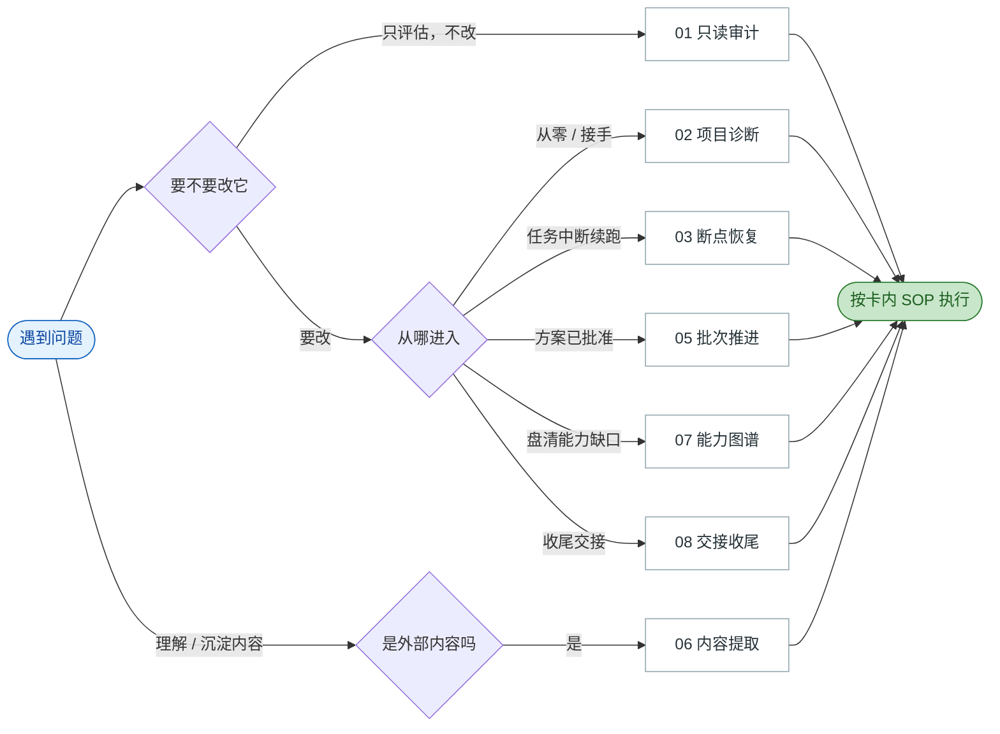
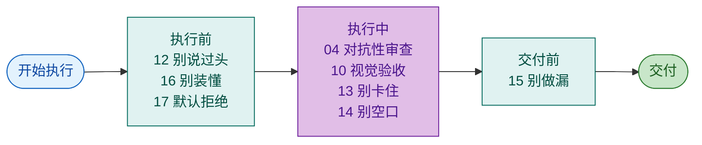
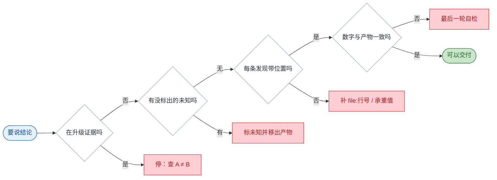

# 经验速查单页

> 从 2,794 个会话（5 个月）蒸馏出的可复用经验。全部过了双模型复现门。
> 完整卡见 `../cards/`，方法与证据见 `元层-蒸馏方法.md`、`../05-support-全量.md`。

---

## 图 1 · 选卡：遇到问题先走这里



**7 张问题类卡**：只读审计 → 项目诊断 → 断点恢复 → 批次推进 → 内容提取 → 能力图谱 → 交接收尾。

---

## 图 2 · 纪律叠加：三个时机各挂哪张



| 时机 | 挂哪张 | 一句话 |
|---|---|---|
| **执行前** | 12 证据升级拒绝 | 别说过头：A ≠ B |
| | 16 未知标注 | 别装懂：不知道就标出来 |
| | 17 默认拒绝 | 默认不放行，全过才放 |
| **执行中** | 04 对抗性审查 | 找"看似通过但未证明" |
| | 10 视觉验收 | 有 UI / 可视化产物时 |
| | 13 阻塞报告 | 遇阻时：报阻塞 + 给替代 |
| | 14 证据锚定 | 每条发现带回查路径 |
| **交付前** | 15 完成前自检 | 核对一致性，不是重读全文 |

---

## 图 3 · 交付前红线：过不了就别交



**四条红线**：不升级证据 · 不隐藏未知 · 不空口无据 · 不做漏。

---

## 核心句（缺了就退化）

| 卡 | 核心句 |
|---|---|
| 01 只读审计 | `保持全程只读；结论带回查路径` |
| 02 项目诊断 | `而不是只做代码走查` |
| 03 断点恢复 | `先验证断点，不直接照旧结论执行` |
| 04 对抗性审查 | `重点寻找"看似通过但未证明"的环节` |
| 05 批次推进 | `测试绿 ≠ 风险关闭；门未过 ≠ 可推进` |
| 06 内容提取 | `不把来源事实和候选设计混为一谈` |
| 07 能力图谱 | `覆盖与缺口都要标，不是只列功能` |
| 08 交接收尾 | `确保推送的是本次核实过的完整状态` |
| 10 视觉验收 | `这是环境限制，不是产物有问题` |
| 12 证据升级拒绝 | `A 不等于 B` |
| 13 阻塞报告 | `{阻塞} 是 {原因}；因此我会 {替代路径}` |
| 14 证据锚定 | `{file:行号} {承重值}，紧邻结论` |
| 15 完成前自检 | `核对 {证据数字}、{一致性}、{占位/遗漏}` |
| 16 未知标注 | `{X} 无法核实，标为 {待验证}，不进入 {结论}` |
| 17 默认拒绝 | `只有 {全部条件} 通过才放行；任一失败即阻断` |
| 18 边界指令 | `不要 {X}，只要 {Y}；到 {程度} 就停` |
| 19 状态继承 | `只重算 {自产状态}，其余继承` |

---

## 使用方式

1. **图 1** → 定位问题类，打开对应卡。
2. **图 2** → 按时机叠加纪律。
3. **图 3** → 交付前逐条过红线。
4. **卡内** → 照 SOP 做；踩坑前读"反例与坑"；想复制抄"指令形状"。

---

## ⚠️ 反模式清单（见 [反模式清单.md](反模式清单.md)）

| # | 反模式 | 一句话 |
|---|---|---|
| 1 | 误判根因 | 以为 A，实际 B |
| 2 | 过度扩展 | 改了不需要改的 |
| 3 | 重复劳动 | 重跑已完成的事 |
| 4 | 过早动手 | 没探清就改 |
| 5 | 过度探索 | 该给结论还在扫 |
| 6 | 产物形态错 | 给工程，要单页 |
| 7 | 工具误用 | 用了不该用的 |
| 8 | 顺序颠倒 | 该先做 X 却先做 Y |

## ⚠️ 稀有真经（低频但硬，见 [稀有真经.md](稀有真经.md)）

| 场景 | 一句话 | 覆盖 |
|---|---|---:|
| 工具输出反常 | **反常信号不忽略，停下来查** | 2% |
| 检查通过但没底 | **区分"形式通过"与"实质成立"** | 1% |
| 自己搞砸了 | **先恢复现场，再说下一步** | 2% |
| 收口汇报 | 说 **"只剩 X"**，别说"基本完成" | 10% |
| 有现成工具/旧结论 | **拒绝默认做法，先验证适配** | 4% |

## ⚠️ 不予发布（别当经验用）

| 卡 | 为什么 |
|---|---|
| **09 调试排障** | 核心句是脚手架（0/20 证据）；真"报错→修复"仅 ~2/20 |
| **11 组织/角色设计** | 有效样本仅 2–3 个且同一项目；承重行为各只出现 1 次 |

---

## 手册结构

```
books/
├── 速查单页.md          ← 本文件（三张决策图）
├── 00-总索引.md
├── 元层-蒸馏方法.md      ★ 怎么生产经验
├── 稀有真经.md          ★ 低频但硬
├── 跨岗通用.md           01 / 03 / 04
├── A-商业分析专家.md      06 / 10
├── B-Agent全栈专家.md     02 / 05 / 07 / 08
└── C-资深产品经理.md      02 / 05 / 06 / 10

cards/   17 张发布（9 问题类 + 2 技法 + 6 纪律）
```

## 置信分布

| 置信 | 卡 |
|---|---|
| **高** | 01 只读审计 · 03 断点恢复 · 12 证据升级拒绝 · 13 阻塞报告 · 14 证据锚定 · 15 完成前自检 · 16 未知标注 |
| **中高** | 04 对抗性审查 · 05 批次推进 · 08 交接收尾 |
| **中** | 02 项目诊断 · 06 内容提取 · 07 能力图谱 · 10 视觉验收 · 17 默认拒绝 · 18 边界指令 · 19 状态继承 |
